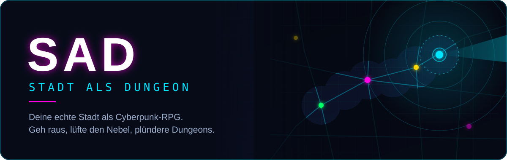
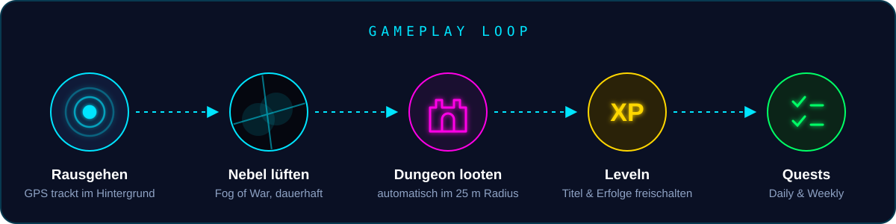
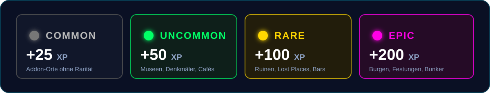

<p align="center">
  
</p>

<p align="center">
  
  
  
  
</p>

<p align="center">
  <b>Deine Stadt ist ein Dungeon.</b> SAD verwandelt echte Orte aus OpenStreetMap in Dungeons,<br>
  hüllt die Karte in Nebel und belohnt dich für jeden Meter, den du wirklich gehst.
</p>

---


## Worum geht's?

**SAD (Stadt Als Dungeon)** ist ein Location-based Game im Cyberpunk-Look. Die App trackt deine Position, deckt die Karte nur dort auf, wo du physisch warst, und lässt dich Ruinen, Bunker, Burgen und Lost Places in deiner Umgebung „looten“. Kein Server, kein Account, alles läuft lokal auf dem Gerät.

<p align="center">
  
</p>

## Dungeon-Raritäten

Jeder Dungeon basiert auf einem echten OSM-Objekt. Wie selten er ist, hängt von seinen Tags ab:

<p align="center">
  
</p>

> Die Farben der Raritäten lassen sich in den Einstellungen frei anpassen.

---

## Features

| | |
|---|---|
| 🛰️ **Aktiver Radar** | Foreground-Service trackt deinen Standort und lootet Dungeons auch bei gesperrtem Bildschirm. |
| 🌫️ **Fog of War** | Die Karte ist dunkel. Nur Gebiete, in denen du warst, bleiben dauerhaft sichtbar. Optional mit Präzisionsmodus (20 m) und Verbindungslinien. |
| 🏰 **Dungeon-System** | Common, Uncommon, Rare und Epic, generiert aus echten OpenStreetMap-Daten. |
| ⭐ **Level, Titel & Erfolge** | XP sammeln, vom *Neuling* zum *Gott-Status* aufsteigen und Achievements freischalten (z. B. für nächtliche Erkundungen). |
| 📋 **Daily & Weekly Quests** | Täglich 3 neue Quests aus einem Pool von 100, wöchentlich 3 schwere aus 50, dazu Statistiken (Strecke, Bereiche, Raritäten). |
| 📡 **Gerüchte (P2P)** | Triff andere Spieler in echt: Über Google Nearby (Bluetooth/WLAN) tauscht ihr automatisch Gerüchte über Fundorte aus, ganz ohne Server. |
| 🧩 **Addon Hub** | Community-Dungeon-Packs als `.json` oder `.db` importieren, an- und ausschalten und eigene Funde als Pack exportieren. |
| 🤖 **KI-Modding** | Ein Knopfdruck kopiert einen Master-Prompt, mit dem ChatGPT, Claude oder Gemini fertige Addon-Packs für jede Stadt erzeugen. |
| 🎨 **Themes** | Legacy Cyberpunk, Light, Inferno und Matrix. Alle Screens und Kartenelemente passen sich an. |
| 🎵 **Hintergrundmusik** | Eigene Playlist (.mp3, .wav, .ogg, .flac) mit Loop/Shuffle, Lautstärke und sanftem Fade beim App-Wechsel. |
| 💾 **Backup & Restore** | Spielstand als JSON exportieren und auf einem neuen Gerät wiederherstellen. |
| 🪪 **Profilkarte** | Teilbare Operative-Karte mit Level, Stats und Glow-Effekten. |

---

## Installation

### Variante A: APK
Lade die aktuelle APK aus den [Releases](../../releases) herunter und installiere sie (Installation aus unbekannten Quellen erlauben).

### Variante B: Selbst bauen

```bash
git clone https://github.com/theStxve/SaD-App.git
cd SaD-App
```

1. Kartendaten erzeugen (siehe [Dungeon-Schmiede](#map-data-pipeline-dungeon-schmiede)). Ohne `app/src/main/assets/places.db` startet die App ohne Dungeons.
2. Projekt in Android Studio öffnen.
3. Auf ein Gerät mit Android 8.0+ flashen.

> **Hinweis:** Für das erste Laden der Kartenkacheln braucht die App Internet. Danach funktionieren Tracking, Nebel und Dungeons auch offline, bereits geladene Kartenbereiche bleiben im Cache.

---

## Map Data Pipeline (Dungeon-Schmiede)

Die ganze Stadt ist ein einziger großer Dungeon. Um deine Region zu importieren, nutze die Pipeline im [`scripts/`](scripts/)-Ordner.

> **Voraussetzung:** [Python 3.9+](https://www.python.org/downloads/) (unter Windows beim Setup *„Add Python to PATH“* ankreuzen).

**1. Karte herunterladen:** eine `.osm.pbf` für deine Region (z. B. ein Bundesland) von [Geofabrik](https://download.geofabrik.de/europe/germany.html) laden und als `scripts/map.osm.pbf` ablegen.

**2. Schmieden:**

```bash
# Windows: Doppelklick auf scripts/process_map.bat (installiert osmium automatisch)

# Linux / macOS
pip install osmium
python scripts/process_map.py
```

Das Skript filtert alle passenden OSM-Objekte (Ruinen, Bunker, Burgen, verlassene Bahnstrecken, Museen …), weist ihnen eine Rarität zu und schreibt sie nach `app/src/main/assets/places.db`.

---

## Eigene Addons (Dungeon-Packs)

### Methode A: JSON-Addon (empfohlen, KI-gestützt)
1. In der App den **Addon Hub** öffnen.
2. Im Modding Guide auf **KI-PROMPT KOPIEREN** tippen.
3. Prompt in ChatGPT, Claude oder Gemini einfügen und die Wunschstadt angeben.
4. Das erzeugte JSON speichern und im Addon Hub auf **IMPORTIEREN** tippen.

<details>
<summary><b>Beispiel-Pack anzeigen</b></summary>

```json
[
  {
    "osm_id": "custom_001",
    "name": "Alter Wasserturm",
    "lat": 52.5163,
    "lon": 13.3777,
    "rarity": "epic",
    "type": "tower",
    "description": "Seit 1987 stillgelegt.",
    "lore": "Man sagt, nachts brennt oben noch Licht.",
    "questHint": "Finde den Eingang auf der Nordseite.",
    "xpReward": 300,
    "iconColor": "#FF8C00",
    "minZoom": 14.0
  }
]
```

| Feld | Pflicht | Beschreibung |
|---|:---:|---|
| `name`, `lat`, `lon` | ✅ | Name und Position des Dungeons |
| `rarity` | | `common`, `uncommon`, `rare` oder `epic` |
| `iconColor` | | Hex-Farbe für den Kartenmarker |
| `minZoom` | | Marker erst ab diesem Zoom-Level sichtbar |
| `description`, `lore`, `questHint`, `xpReward` | | Story und Gameplay-Extras |

Ein Eintrag mit `"osm_id": "*"` (ohne Koordinaten) wirkt als globale Regel, z. B. um allen Markern eine Farbe zu geben.
</details>

### Methode B: `.db`-Pipeline
```bash
python scripts/process_map.py scripts/deine_region.osm.pbf scripts/pack.db
```
`pack.db` aufs Smartphone übertragen und im Addon Hub importieren.

---

## Tech-Stack

| Bereich | Technologie |
|---|---|
| Sprache | Kotlin |
| UI | Jetpack Compose, Material 3 |
| Datenbank | Room / SQLite (Orte aus Assets + separater Spielstand) |
| Karte | osmdroid (OpenStreetMap) |
| Standort | Google Play Services Fused Location, Foreground Service |
| P2P | Google Nearby Connections |
| Datenpipeline | Python + pyosmium |

---

## Disclaimer

SAD ist ein Spiel für Entdecker. Trotzdem gilt:

1. **Betreten auf eigene Gefahr:** Betritt niemals Privatgelände oder gefährliche Areale (Lost Places) ohne Erlaubnis.
2. **Sicherheit geht vor:** Achte auf deine Umgebung, besonders bei nächtlichen Erkundungen und im Straßenverkehr.
3. **Haftung:** Der Entwickler übernimmt keinerlei Haftung für Schäden, Unfälle oder rechtliche Konsequenzen, die durch die Nutzung der App entstehen.
4. **Datenschutz:** GPS-Daten bleiben auf deinem Gerät und werden nur für Nebel und Dungeons genutzt. Beim Gerüchte-Austausch wird der Ort eines von dir besuchten Dungeons an Spieler in der Nähe gesendet.

Kartendaten © [OpenStreetMap](https://www.openstreetmap.org/copyright)-Mitwirkende, verfügbar unter der ODbL.

---

<p align="center"><i>„Die Stadt ist kein Ort, sie ist ein Dungeon. Geh raus und erobere sie.“</i></p>
